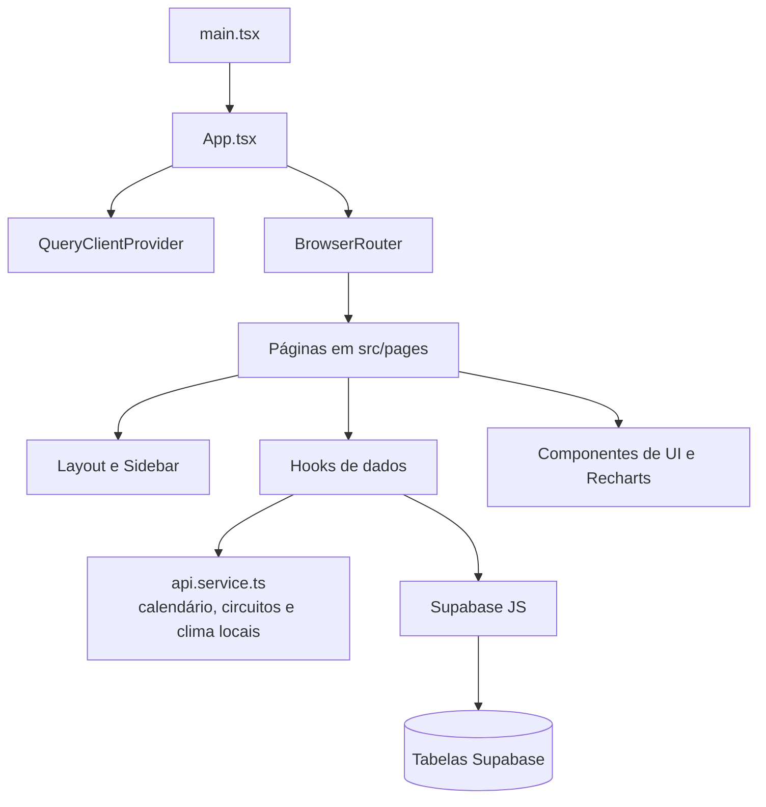

# F1 Data Dashboard

Dashboard web em português brasileiro para consulta e visualização de informações de Fórmula 1. A aplicação reúne calendário de fins de semana, detalhes de circuitos, previsão meteorológica, gráficos de estatísticas, evolução de campeonato, telemetria demonstrativa, histórico de construtores e um módulo de palpites persistido no Supabase.

O projeto resolve a necessidade de concentrar essas visões em uma única interface responsiva, com navegação por rotas e componentes reutilizáveis. O estado atual combina dados locais/mockados com dados consultados diretamente no Supabase; portanto, nem todas as telas representam dados oficiais ou em tempo real.

## Índice

- [Estado atual](#estado-atual)
- [Funcionalidades](#funcionalidades)
- [Tecnologias](#tecnologias)
- [Arquitetura](#arquitetura)
- [Rotas](#rotas)
- [Estrutura do projeto](#estrutura-do-projeto)
- [Pré-requisitos](#pré-requisitos)
- [Instalação e configuração](#instalação-e-configuração)
- [Execução e scripts](#execução-e-scripts)
- [Dados e integrações](#dados-e-integrações)
- [Fluxos principais](#fluxos-principais)
- [Segurança](#segurança)
- [Build e deploy](#build-e-deploy)
- [Manutenção e evolução](#manutenção-e-evolução)
- [Limitações conhecidas](#limitações-conhecidas)

## Estado atual

O repositório contém um frontend React funcional, mas ainda em estágio de protótipo em algumas áreas:

- O histórico de construtores consulta o Supabase e calcula rankings no cliente.
- O módulo de palpites lê perfis e palpites e permite criar, atualizar e excluir registros no Supabase.
- Calendário, circuitos e clima são fornecidos por dados estáticos em `src/services/api.service.ts`.
- Estatísticas, campeonato, telemetria e parte dos palpites exibidos são dados de exemplo ou gerados aleatoriamente no navegador.
- Não há backend próprio, API de Fórmula 1 integrada, autenticação de usuários, geração de documentos ou armazenamento de arquivos implementados no código.

## Funcionalidades

### Dashboard

Disponível em `/`, apresenta o próximo ou atual fim de semana de corrida, contagem regressiva para a próxima sessão, informações do circuito, programação, clima e classificações demonstrativas de pilotos e construtores.

### Calendário

Disponível em `/calendar`, permite:

- Selecionar uma temporada entre 2019 e 2025;
- Visualizar em um calendário os dias abrangidos por cada evento;
- Consultar localização, datas, sessões e duração de cada fim de semana;
- Listar os GPs presentes no calendário local.

O seletor de temporada altera o texto da interface, mas o serviço atualmente retorna apenas o calendário estático definido no código.

### Estatísticas

Disponível em `/stats`, exibe gráficos de barras e pizza para pontos, ultrapassagens, vitórias, voltas rápidas e tempo médio de pit stop. Os dados estão hardcoded em `src/pages/Statistics.tsx` e não são carregados do Supabase.

### Campeonato

Disponível em `/championship`, mostra a evolução acumulada de pilotos e construtores em gráficos. Os pontos são gerados aleatoriamente a cada renderização por `generateChampionshipData`, não representando resultados históricos persistidos.

### Telemetria

Disponível em `/telemetry`, permite selecionar piloto, circuito e sessão e visualizar velocidade, acelerador, freio e degradação de pneus. Os valores são simulados com `Math.random()` em `src/pages/Telemetry.tsx`; não há ingestão de telemetria real.

### Palpites

Disponível em `/predictions`, permite selecionar um perfil e registrar para o próximo GP:

- Vencedor da corrida;
- Pole position;
- Pódio com três pilotos;
- Equipe vencedora.

O formulário exige os quatro campos e substitui automaticamente o primeiro piloto quando o usuário tenta selecionar um quarto nome para o pódio. O salvamento usa `upsert` na tabela `predictions`. As abas de histórico e ranking ainda exibem valores fixos, e os dados do parceiro exibidos na aba da próxima corrida também são estáticos.

### Previsões

Disponível em `/forecast`, apresenta probabilidades, adequação à pista e impacto climático com valores demonstrativos. A aba de histórico da pista informa que será implementada futuramente.

### História e construtores

- `/historia` apresenta cartões de navegação para construtores, pilotos e campeonatos.
- `/historia/construtores` consulta o Supabase para listar construtores, calcular os dez maiores por pontos e vitórias, agrupar nacionalidades e pesquisar por nome/nacionalidade.
- `/constructors` apresenta uma versão resumida dos mesmos rankings históricos.

Os links `/historia/pilotos` e `/historia/campeonatos` são exibidos em `/historia`, mas não possuem rotas registradas em `src/App.tsx`; atualmente caem na tela 404.

## Tecnologias

| Categoria | Tecnologia | Uso no projeto |
| --- | --- | --- |
| Interface | React 18 | Componentes e páginas da aplicação |
| Linguagem | TypeScript | Tipagem de componentes, hooks e modelo de dados |
| Build/dev server | Vite 5 | Desenvolvimento local e build de produção |
| Roteamento | React Router DOM 6 | Rotas client-side |
| Estado assíncrono | TanStack React Query 5 | Cache, consultas e mutações |
| Dados externos | Supabase JS 2 | Consultas e alterações no banco PostgreSQL do Supabase |
| Estilos | Tailwind CSS 3, PostCSS e Autoprefixer | Layout, responsividade e tema |
| Componentes | Radix UI e padrão shadcn/ui | Primitivos acessíveis em `src/components/ui` |
| Gráficos | Recharts | Gráficos estatísticos, históricos e de telemetria |
| Formulários/validação | React Hook Form, Zod e resolvers | Dependências disponíveis; não são o fluxo principal das páginas atuais |
| Ícones | Lucide React | Ícones da navegação e das telas |
| Datas | date-fns | Formatação do calendário |

## Arquitetura

A aplicação é uma SPA (Single-Page Application). O ponto de entrada cria a árvore React em `src/main.tsx`; `src/App.tsx` configura provedores globais e o roteador. As páginas compõem `Layout`, que fornece a navegação lateral, e usam hooks para acessar serviços ou Supabase.



### Camadas e responsabilidades

- **Inicialização e composição:** `src/main.tsx` e `src/App.tsx` montam React, React Query, tooltips, toasts e rotas.
- **Páginas:** `src/pages` coordena a apresentação e as interações de cada funcionalidade.
- **Layout:** `src/components/Layout.tsx` e `src/components/Sidebar.tsx` controlam a estrutura comum, navegação e alternância de tema.
- **Hooks:** `src/hooks` encapsula consultas React Query, cache e mutações.
- **Serviço local:** `src/services/api.service.ts` expõe `f1ApiService`, que retorna dados estáticos com atrasos artificiais para simular chamadas assíncronas.
- **Integração de dados:** `src/integrations/supabase/client.ts` cria o cliente tipado usado pelas telas históricas e de palpites.
- **Tipos:** `src/types/f1.types.ts` define modelos gerais de corrida, circuitos, clima, classificações e palpites; `src/integrations/supabase/types.ts` descreve as tabelas conhecidas.
- **UI reutilizável:** `src/components/ui` contém componentes baseados em Radix UI, no padrão shadcn/ui.

O `QueryClient` global desabilita refetch ao focar a janela e limita tentativas a uma (`retry: 1`). Os hooks definem tempos de cache próprios, como uma hora para corridas e 24 horas para circuitos e calendários.

## Rotas

| Caminho | Página | Origem dos dados |
| --- | --- | --- |
| `/` | Dashboard | Serviço local e dados demonstrativos |
| `/calendar` | Calendário | Serviço local |
| `/stats` | Estatísticas | Arrays locais |
| `/championship` | Campeonato | Dados gerados aleatoriamente |
| `/telemetry` | Telemetria | Dados gerados aleatoriamente |
| `/predictions` | Palpites | Supabase, serviço local e dados fixos |
| `/forecast` | Previsões | Dados demonstrativos; consulta de construtores não usada na visualização |
| `/constructors` | Rankings de construtores | Supabase |
| `/historia` | Índice de história | Conteúdo estático |
| `/historia/construtores` | História de construtores | Supabase |
| `*` | 404 | Rota não encontrada |

## Estrutura do projeto

```text
.
├── public/                         # favicon, imagem Open Graph e placeholder
├── src/
│   ├── components/                 # layout, cards, gráficos e componentes UI
│   │   ├── historia/               # componentes específicos da história
│   │   └── ui/                     # primitives Radix/shadcn-ui
│   ├── hooks/                      # hooks de consulta, mutação e responsividade
│   ├── integrations/supabase/      # cliente, tipos, seed e teste de conexão
│   ├── lib/                        # utilitários e cliente Supabase alternativo
│   ├── pages/                      # páginas associadas às rotas
│   ├── services/                   # serviço local de dados F1
│   ├── types/                      # tipos de domínio da F1
│   ├── App.tsx                     # provedores e definição de rotas
│   ├── index.css                   # tokens e estilos globais
│   └── main.tsx                    # ponto de entrada
├── supabase/config.toml            # identificador do projeto Supabase local
├── .env.example                    # nomes esperados de variáveis
├── package.json                    # dependências e scripts
├── package-lock.json               # lockfile npm
├── vite.config.ts                  # servidor e build Vite
├── tailwind.config.ts              # tema e conteúdo Tailwind
└── tsconfig*.json                  # configuração TypeScript
```

## Pré-requisitos

- Node.js e npm instalados;
- Acesso ao projeto Supabase usado pela aplicação, se forem utilizadas as telas de construtores ou palpites;
- Credenciais públicas do Supabase configuradas conforme o ambiente de execução.

O repositório não declara uma versão mínima de Node.js em `package.json`. Para reproduzir exatamente as versões das dependências, prefira `npm ci`, que usa `package-lock.json`.

## Instalação e configuração

1. Clone o repositório e entre na pasta do projeto:

   ```bash
   git clone <URL_DO_REPOSITORIO>
   cd f1-data-dashboard
   ```

2. Instale as dependências:

   ```bash
   npm ci
   ```

   `npm install` também é compatível, mas pode atualizar o lockfile quando houver divergência.

3. Crie o arquivo local de ambiente a partir do exemplo:

   ```bash
   cp .env.example .env
   ```

   No PowerShell, o equivalente é:

   ```powershell
   Copy-Item .env.example .env
   ```

4. Preencha valores reais apenas no `.env` local:

   ```dotenv
   VITE_SUPABASE_URL=https://seu-projeto.supabase.co
   VITE_SUPABASE_ANON_KEY=sua_chave_anonima
   ```

   Esses são os nomes consumidos por `src/lib/supabase.ts`. Entretanto, as telas atualmente usadas importam `src/integrations/supabase/client.ts`, que contém uma configuração pública fixa no código. A configuração por ambiente só será aplicada a essas telas depois que o cliente ativo for alterado para usar as variáveis acima; esse ponto deve ser tratado antes de um deploy controlado.

## Execução e scripts

Inicie o servidor de desenvolvimento:

```bash
npm run dev
```

O Vite está configurado para escutar na porta `8080` (`vite.config.ts`). A URL efetiva pode depender da resolução de host do ambiente.

Scripts declarados em `package.json`:

| Script | Comando | Finalidade |
| --- | --- | --- |
| `dev` | `vite` | Servidor de desenvolvimento com atualização automática |
| `build` | `vite build` | Build padrão de produção em `dist/` |
| `build:dev` | `vite build --mode development` | Build usando o modo de desenvolvimento |
| `lint` | `eslint .` | Verificação estática do repositório |
| `preview` | `vite preview` | Servir localmente o build já gerado |

Os arquivos `src/integrations/supabase/seed-data.ts` e `test-connection.ts` são módulos auxiliares, não scripts declarados no `package.json`. O projeto não inclui um executor TypeScript dedicado para executá-los diretamente; não há, portanto, um comando oficial de seed ou diagnóstico no estado atual.

## Dados e integrações

### Supabase

O cliente tipado de `src/integrations/supabase/client.ts` usa `@supabase/supabase-js`. As tabelas descritas em `src/integrations/supabase/types.ts` são:

| Tabela | Uso |
| --- | --- |
| `constructors` | Cadastro, nome, nacionalidade e URL dos construtores |
| `constructor_results` | Pontos e resultados por construtor/corrida |
| `constructor_standings` | Classificação e vitórias por construtor/corrida |
| `profiles` | Perfis usados no módulo de palpites |
| `predictions` | Palpites por perfil, GP e temporada |
| `circuits` | Modelo tipado presente no schema; não é consultado pelos hooks atuais |

As consultas históricas fazem agregações no navegador:

- `useTopConstructors` soma `points` de `constructor_results` por nome e retorna os dez primeiros;
- `useTopConstructorsByWins` soma `wins` de `constructor_standings` por construtor e retorna os dez primeiros;
- `useConstructorNationalities` conta construtores por nacionalidade;
- `useConstructors` lista os construtores em ordem alfabética;
- `useConstructorResults` busca até dez resultados recentes e tenta incluir dados relacionados de `races`.

O tipo local menciona a relação com `races`, mas essa tabela não está declarada no tipo `Database` versionado. A existência da tabela e da relação precisa ser confirmada no projeto Supabase antes de depender desse hook.

### Palpites e perfis

`src/hooks/usePredictionsData.ts` implementa:

- leitura de todos os perfis;
- criação/atualização de perfil com `upsert`;
- exclusão de perfil;
- leitura de um palpite por `profile_id`, GP e temporada;
- leitura dos palpites de um perfil, opcionalmente filtrados por temporada;
- criação/atualização e exclusão de palpites.

O código não chama `supabase.auth` e não há fluxo de login, cadastro, sessão ou papéis de usuário. O controle efetivo de acesso depende das políticas RLS configuradas no Supabase, que não estão versionadas neste repositório.

### Dados locais e simulados

`src/services/api.service.ts` fornece três GPs de 2025 (Austrália, China e Japão), detalhes de três circuitos, clima apenas para Albert Park e exemplos de palpites. Os métodos retornam Promises com atrasos artificiais de 300 a 500 ms.

As telas de estatísticas, campeonato, telemetria e previsões usam constantes locais ou valores aleatórios. O nome e o texto da interface não devem ser interpretados como indicação de uma integração em tempo real.

## Fluxos principais

### Carregamento do dashboard

1. `useDashboardData` consulta o fim de semana atual e o próximo via `f1ApiService`.
2. O fim de semana atual tem precedência; se não houver, usa-se o próximo.
3. O `circuitId` selecionado alimenta as consultas de circuito e clima.
4. `Index.tsx` calcula a próxima sessão futura e renderiza contagem regressiva, circuito, agenda e clima.
5. As classificações e os palpites do card inicial são dados demonstrativos independentes do Supabase.

### Consulta histórica de construtores

1. A página dispara quatro hooks React Query.
2. Os hooks consultam `constructors`, `constructor_results` e `constructor_standings`.
3. Pontos, vitórias e nacionalidades são agregados no cliente.
4. A interface exibe cards de resumo, gráficos e uma lista pesquisável.
5. Links externos de cada construtor apontam para a URL armazenada no banco.

### Salvamento de palpites

1. A página carrega os perfis e seleciona o primeiro automaticamente quando nenhum está selecionado.
2. O próximo GP vem do serviço local.
3. Um palpite existente é carregado para o perfil, GP e temporada selecionados.
4. O usuário escolhe vencedor, pole, três nomes para o pódio e equipe vencedora.
5. A validação local impede salvar sem perfil, corrida ou campos completos.
6. A mutação executa `upsert` em `predictions` e invalida as queries relacionadas.
7. Toasts informam sucesso ou erro.

## Segurança

- Nunca commite `.env`, tokens, chaves privadas ou credenciais de serviço. O `.gitignore` atual não lista explicitamente `.env`; trate-o como informação sensível e verifique o status do Git antes de qualquer commit.
- As variáveis `VITE_*` são incorporadas ao bundle do navegador. Elas não podem conter segredos; use apenas uma chave pública/anon com RLS corretamente configurado.
- O cliente ativo em `src/integrations/supabase/client.ts` possui URL e chave pública embutidas no código. Embora a chave anon não seja um segredo de servidor, essa prática dificulta rotação e configuração por ambiente; mova a configuração para variáveis de ambiente antes de publicar uma nova versão.
- Não existe autenticação ou autorização na aplicação. As operações de criação, atualização e exclusão devem ser protegidas por políticas RLS no Supabase, validadas fora deste repositório.
- Links externos usam `target="_blank"` com `rel="noopener noreferrer"` nas páginas de construtores.
- O repositório não contém migrations nem regras RLS. O schema, políticas, backups e permissões precisam ser mantidos no projeto Supabase ou adicionados ao versionamento.

## Build e deploy

Gere o build:

```bash
npm run build
```

O resultado é criado em `dist/`. Para uma conferência local:

```bash
npm run preview
```

O Vite divide os chunks de React/Router e Supabase conforme `vite.config.ts`, usa minificação Terser e não gera sourcemaps. O repositório não define um provedor, pipeline CI/CD, comando de deploy ou configuração de servidor para SPA. Em qualquer hospedagem, é necessário configurar fallback para `index.html` nas rotas client-side e fornecer a configuração do ambiente no momento do build.

## Manutenção e evolução

Ao alterar o projeto:

1. Atualize os tipos em `src/types` ou `src/integrations/supabase/types.ts` junto com a alteração do contrato de dados.
2. Mantenha consultas Supabase encapsuladas nos hooks de `src/hooks`, invalidando as chaves React Query afetadas após mutações.
3. Substitua os dados locais por uma fonte oficial antes de chamar uma tela de tempo real, histórico ou previsão de produção.
4. Adicione migrations, índices e políticas RLS ao versionamento antes de ampliar o schema.
5. Registre novas páginas em `src/App.tsx` e na navegação de `src/components/Sidebar.tsx`.
6. Execute `npm run lint` e `npm run build` antes de abrir um pull request.
7. Valide as rotas diretamente após o deploy, especialmente em refresh de URLs diferentes de `/`.

Melhorias prioritárias identificadas no código:

- substituir o cliente Supabase hardcoded por configuração de ambiente única;
- integrar dados reais de pilotos, equipes, calendário, clima, resultados e telemetria;
- implementar autenticação e políticas RLS alinhadas ao módulo de palpites;
- concluir histórico e ranking de palpites, incluindo cálculo de pontuação;
- remover a aleatoriedade de campeonato e telemetria;
- adicionar as rotas de pilotos e campeonatos ou remover os links ainda não implementados;
- criar migrations e um mecanismo reprodutível para seed/teste de conexão;
- adicionar testes automatizados para hooks, agregações e regras do pódio.

## Limitações conhecidas

- Não há API backend própria: o navegador acessa o Supabase diretamente.
- Calendário, circuitos e clima são limitados aos registros estáticos presentes no serviço local.
- A seleção de temporada não altera a fonte de dados da maioria das telas.
- Classificações do dashboard, estatísticas, previsões, campeonato e telemetria não são dados oficiais persistidos.
- O próximo GP dos palpites é obtido do calendário local e pode ficar vazio quando todos os eventos estáticos estiverem no passado.
- O histórico de construtores depende de tabelas e relacionamentos que não são provisionados pelo repositório.
- O schema tipado não substitui uma migration real; diferenças entre o tipo e o banco só serão descobertas em execução.
- Não há testes automatizados nem pipeline de integração contínua configurados.
- O carregamento de fontes externas em `index.html` depende de conectividade com Google Fonts e um script externo de engenharia; a necessidade desse script deve ser avaliada em ambientes controlados.

## Licença

Não há arquivo de licença no repositório. Os termos de uso e redistribuição precisam ser definidos pelos responsáveis pelo projeto.
